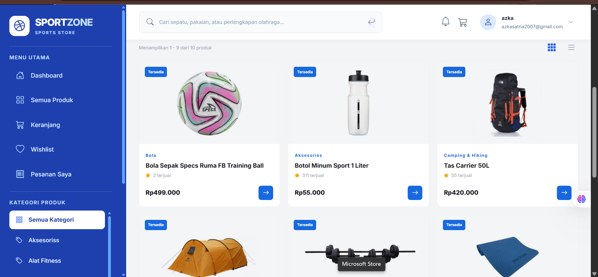
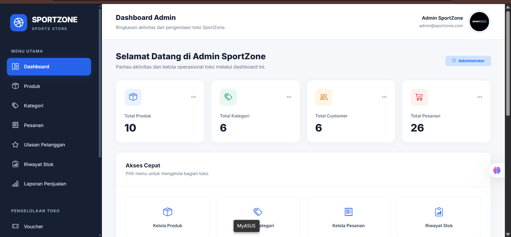

 <div align="center">


# SPORTZONE

### SPORTS EQUIPMENT E-COMMERCE WEB APPLICATION

**Aplikasi E-Commerce Penjualan Perlengkapan Olahraga Berbasis Web**

<br>


<br><br>

**PROYEK AKHIR PRAKTIKUM PEMROGRAMAN WEB**

**IF-A · KELOMPOK 11**

</div>

---

## 📑 Daftar Isi

- [Tentang Proyek](#-tentang-proyek)
- [Preview Aplikasi](#-preview-aplikasi)
- [Fitur Aplikasi](#-fitur-aplikasi)
- [Teknologi yang Digunakan](#-teknologi-yang-digunakan)
- [Konsep Pembelajaran](#-konsep-pembelajaran-yang-diterapkan)
- [Struktur Database](#-struktur-database)
- [Persyaratan Sistem](#-persyaratan-sistem)
- [Instalasi dan Menjalankan Proyek](#-instalasi-dan-menjalankan-proyek)
- [Akun Demo](#-akun-demo)
- [Pengembangan Selanjutnya](#-pengembangan-selanjutnya)
- [Tim Pengembang](#-tim-pengembang)
- [Status Proyek](#-status-proyek)

---

## 📌 Tentang Proyek

**SportZone** merupakan aplikasi e-commerce berbasis web yang dikembangkan untuk menyediakan platform penjualan dan pengelolaan perlengkapan olahraga secara online.

Aplikasi ini mengintegrasikan aktivitas pelanggan dan administrator dalam satu sistem. Pelanggan dapat menjelajahi katalog produk, melakukan pembelian, mengelola alamat pengiriman, serta memantau pesanan. Sementara itu, administrator dapat mengelola produk, kategori, stok, transaksi, pembayaran, dan aktivitas operasional toko.

SportZone dikembangkan menggunakan **Laravel 12, PHP, dan MySQL** dengan menerapkan arsitektur **Model-View-Controller (MVC)**. Pengembangan proyek ini juga memanfaatkan HTML, CSS, Bootstrap, dan JavaScript untuk membangun antarmuka yang interaktif dan mudah digunakan.

Proyek ini merupakan bentuk penerapan materi perkuliahan Praktikum Pemrograman Web, khususnya dalam pengembangan aplikasi web dinamis, integrasi basis data, autentikasi, pengelolaan data, dan implementasi alur transaksi e-commerce.

## 🖥️ Preview Aplikasi

### Customer Dashboard

Halaman utama pelanggan untuk melihat katalog perlengkapan olahraga, mencari produk, dan mengakses aktivitas belanja.

<div align="center">
  
  <sub>Customer Dashboard — SportZone</sub>
</div>

### Admin Dashboard

Halaman administrator untuk memantau ringkasan aktivitas toko, statistik, dan mengakses berbagai fitur pengelolaan.

<div align="center">
  
  <sub>Admin Dashboard — SportZone</sub>
</div>

## ✨ Fitur Aplikasi

SportZone memiliki dua bagian utama berdasarkan jenis pengguna.

## 🔄 Alur Penggunaan Aplikasi

SportZone memiliki alur penggunaan yang berbeda untuk pelanggan dan administrator.

### 🛍️ Alur Customer

1. Pelanggan membuka halaman SportZone.
2. Pelanggan melakukan registrasi atau login.
3. Pelanggan menjelajahi katalog dan memilih produk.
4. Pelanggan melihat detail produk dan menentukan variasi serta jumlah pembelian.
5. Pelanggan menambahkan produk ke keranjang atau menggunakan fitur pembelian langsung.
6. Pelanggan memilih atau menambahkan alamat pengiriman.
7. Pelanggan melakukan checkout dan menyelesaikan proses pemesanan.
8. Pelanggan mengunggah bukti pembayaran.
9. Pelanggan menunggu proses verifikasi pembayaran oleh administrator.
10. Pelanggan dapat melihat status pesanan melalui riwayat pesanan dan notifikasi.

### ⚙️ Alur Administrator

1. Administrator melakukan login menggunakan akun admin.
2. Administrator mengakses dashboard untuk melihat aktivitas toko.
3. Administrator mengelola produk, kategori, variasi, dan stok.
4. Administrator memeriksa pesanan yang masuk.
5. Administrator memeriksa bukti pembayaran dari pelanggan.
6. Administrator melakukan konfirmasi atau penolakan pembayaran sesuai hasil pemeriksaan.
7. Administrator mengelola data pelanggan, voucher, dan notifikasi.
8. Administrator melihat laporan penjualan untuk memantau transaksi.

## 🧪 Pengujian Aplikasi

Pengujian dilakukan untuk memastikan fitur-fitur utama SportZone dapat berjalan sesuai dengan fungsi yang diharapkan.

| No. | Fitur yang Diuji | Skenario Pengujian | Hasil yang Diharapkan |
|:---:|---|---|---|
| 1 | Registrasi | Pelanggan mengisi formulir pendaftaran. | Akun pelanggan berhasil dibuat. |
| 2 | Login | Pengguna memasukkan email dan password. | Pengguna berhasil masuk sesuai hak akses. |
| 3 | Katalog Produk | Pengguna membuka halaman katalog. | Daftar produk ditampilkan. |
| 4 | Keranjang | Pelanggan menambahkan produk ke keranjang. | Produk masuk ke keranjang. |
| 5 | Checkout | Pelanggan melakukan proses checkout. | Pesanan berhasil dibuat. |
| 6 | Pembayaran | Pelanggan mengunggah bukti pembayaran. | Bukti pembayaran tersimpan. |
| 7 | Verifikasi Pembayaran | Admin memeriksa bukti pembayaran. | Status pembayaran diperbarui sesuai keputusan admin. |
| 8 | Manajemen Produk | Admin menambah atau mengubah produk. | Data produk berhasil dikelola. |
| 9 | Riwayat Pesanan | Pelanggan membuka riwayat pesanan. | Informasi pesanan ditampilkan. |

**Catatan:** Tabel ini merupakan skenario pengujian. Hasil aktual setiap pengujian perlu diperiksa dan disesuaikan dengan hasil uji aplikasi.

### 🛍️ Customer

| Fitur | Deskripsi |
|---|---|
| Registrasi dan Login | Membuat akun dan masuk ke aplikasi dengan autentikasi pengguna. |
| Katalog Produk | Melihat berbagai perlengkapan olahraga yang tersedia. |
| Pencarian Produk | Mencari produk berdasarkan nama atau informasi produk. |
| Filter dan Kategori | Menjelajahi produk berdasarkan kategori dan pilihan penyaringan. |
| Detail Produk | Melihat informasi, harga, deskripsi, gambar, dan variasi produk. |
| Keranjang Belanja | Menambahkan, mengubah, dan menghapus produk dalam keranjang. |
| Pembelian Langsung | Melakukan pembelian produk tanpa harus memasukkannya ke keranjang. |
| Manajemen Alamat | Menambahkan dan mengelola alamat pengiriman. |
| Checkout | Membuat pesanan dengan informasi produk, alamat, dan total pembayaran. |
| Pembayaran | Mengunggah bukti pembayaran untuk proses verifikasi. |
| Riwayat Pesanan | Melihat daftar pesanan dan perkembangan status transaksi. |
| Notifikasi | Mendapatkan informasi terkait aktivitas dan perubahan pesanan. |
| Ulasan Produk | Memberikan penilaian dan komentar terhadap produk yang telah dibeli. |

### ⚙️ Administrator

| Fitur | Deskripsi |
|---|---|
| Dashboard Admin | Menampilkan ringkasan statistik dan aktivitas toko. |
| Manajemen Produk | Menambah, melihat, mengubah, dan menghapus produk. |
| Manajemen Kategori | Mengelola kategori perlengkapan olahraga. |
| Manajemen Variasi | Mengelola variasi produk berdasarkan ukuran, warna, harga, dan stok. |
| Manajemen Stok | Mengelola ketersediaan stok produk. |
| Manajemen Pesanan | Melihat dan mengelola transaksi pelanggan. |
| Verifikasi Pembayaran | Memeriksa bukti pembayaran dan menentukan hasil verifikasi. |
| Manajemen Pelanggan | Melihat informasi akun pelanggan. |
| Manajemen Voucher | Mengelola voucher dan potongan harga. |
| Notifikasi | Mengelola informasi dan pemberitahuan aplikasi. |
| Laporan Penjualan | Melihat ringkasan dan laporan transaksi berdasarkan periode. |

## 🛠️ Teknologi yang Digunakan

| Teknologi | Kegunaan |
|---|---|
| HTML5 | Membentuk struktur halaman web. |
| CSS3 | Mengatur tampilan dan tata letak antarmuka. |
| Bootstrap 5.3 | Membantu membangun komponen dan desain responsif. |
| Bootstrap Icons | Menyediakan ikon pada antarmuka aplikasi. |
| JavaScript | Menambahkan interaksi dan fungsi dinamis pada halaman. |
| PHP | Menangani logika pemrosesan aplikasi di sisi server. |
| Laravel 12 | Framework utama dengan arsitektur MVC. |
| MySQL | Menyimpan dan mengelola data aplikasi. |
| phpMyAdmin | Membantu administrasi basis data MySQL. |
| Composer | Mengelola dependency PHP. |
| Node.js dan NPM | Mengelola dependency dan kebutuhan frontend. |
| Git dan GitHub | Mengelola versi kode dan repositori proyek. |

## 📚 Konsep Pembelajaran yang Diterapkan

Dalam pengembangan SportZone, beberapa konsep Pemrograman Web yang diterapkan meliputi:

1. **Dasar Pemrograman Web** — penggunaan HTML, CSS, JavaScript, dan PHP.
2. **Framework Laravel** — penerapan routing, controller, Blade template, middleware, dan pola arsitektur MVC.
3. **Basis Data Relasional** — perancangan tabel, relasi antartabel, penggunaan SQL, dan pengolahan data MySQL.
4. **CRUD (Create, Read, Update, Delete)** — pengelolaan data produk, kategori, dan informasi lainnya.
5. **Authentication dan Authorization** — registrasi, login, logout, session, serta pembatasan hak akses berdasarkan peran pengguna.
6. **Session Management** — pengelolaan informasi pengguna dan aktivitas keranjang belanja.
7. **Form Validation** — validasi masukan pengguna sebelum data diproses.
8. **File Upload** — pengunggahan gambar produk dan bukti pembayaran.
9. **Database Transaction** — pengelolaan proses transaksi agar perubahan data pesanan dan stok tetap konsisten.
10. **Version Control** — penggunaan Git dan GitHub untuk pengelolaan perubahan kode dan kolaborasi proyek.

## 🗄️ Struktur Database

SportZone menggunakan **MySQL** sebagai sistem pengelolaan basis data relasional.

Database proyek disediakan dalam file:

```text
database/toko_olahraga.sql
```

File tersebut berisi struktur tabel dan data awal yang diperlukan untuk menjalankan aplikasi.

Secara umum, database mencakup beberapa kelompok data berikut:

| Kelompok | Kegunaan |
|---|---|
| Pengguna | Menyimpan informasi akun administrator dan pelanggan. |
| Produk dan Kategori | Menyimpan informasi produk, kategori, gambar, dan variasi. |
| Keranjang | Menyimpan produk yang dipilih pelanggan sebelum checkout. |
| Alamat | Menyimpan informasi alamat pengiriman pelanggan. |
| Pesanan | Menyimpan transaksi dan detail produk yang dipesan. |
| Pembayaran | Menyimpan informasi pembayaran dan bukti pembayaran. |
| Voucher | Menyimpan informasi kode voucher dan diskon. |
| Ulasan | Menyimpan penilaian dan komentar pelanggan. |
| Notifikasi | Menyimpan informasi pemberitahuan kepada pengguna. |

## 💻 Persyaratan Sistem

Sebelum menjalankan proyek, pastikan perangkat telah memiliki:

| Perangkat Lunak | Keterangan |
|---|---|
| PHP | Versi 8.2 atau lebih tinggi sesuai konfigurasi proyek. |
| Composer | Pengelola dependency PHP. |
| MySQL | Database server. |
| XAMPP | Dapat digunakan untuk menjalankan Apache dan MySQL. |
| phpMyAdmin | Untuk mengelola dan mengimpor database. |
| Node.js dan NPM | Untuk kebutuhan frontend. |
| Git | Untuk mengambil repositori proyek. |
| Web Browser | Google Chrome atau browser lainnya. |

## 🚀 Instalasi dan Menjalankan Proyek

Ikuti langkah-langkah berikut untuk menjalankan SportZone di komputer lokal.

### 1. Clone Repository

Buka terminal atau CMD, kemudian jalankan:

```bash
git clone https://github.com/azkoy07/PROYEK-AKHIR-PW-IF-A-KELOMPOK-11.git
```

Masuk ke direktori proyek:

```bash
cd PROYEK-AKHIR-PW-IF-A-KELOMPOK-11
```

### 2. Install Dependencies

Install seluruh dependency PHP:

```bash
composer install
```

Install dependency frontend:

```bash
npm install
```

### 3. Konfigurasi Environment

Buat file `.env` berdasarkan file `.env.example`.

Untuk Windows Command Prompt:

```bat
copy .env.example .env
```

Untuk Linux/macOS:

```bash
cp .env.example .env
```

Generate application key:

```bash
php artisan key:generate
```

### 4. Buat dan Import Database

SportZone menyediakan database dalam bentuk file SQL sehingga tabel tidak perlu dibuat satu per satu secara manual.

Ikuti langkah berikut:

1. Jalankan MySQL melalui XAMPP.
2. Buka phpMyAdmin melalui `http://localhost/phpmyadmin`.
3. Buat database baru dengan nama:

   ```text
   toko_olahraga
   ```

4. Pilih database `toko_olahraga`.
5. Buka menu **Import**.
6. Pilih file `database/toko_olahraga.sql` dari folder proyek.
7. Klik **Import** atau **Go**.
8. Tunggu hingga proses import selesai.

Setelah berhasil, tabel-tabel SportZone akan tersedia di database MySQL.

### 5. Konfigurasi Koneksi Database

Buka file `.env`, kemudian sesuaikan konfigurasi database:

```env
DB_CONNECTION=mysql
DB_HOST=127.0.0.1
DB_PORT=3306
DB_DATABASE=toko_olahraga
DB_USERNAME=root
DB_PASSWORD=
```

Sesuaikan username dan password dengan konfigurasi MySQL pada komputer masing-masing.

Setelah itu, bersihkan konfigurasi Laravel:

```bash
php artisan config:clear
```

**Catatan:** Untuk instalasi menggunakan file SQL yang disediakan, import database terlebih dahulu melalui phpMyAdmin. Tidak perlu menjalankan `php artisan migrate` untuk membuat ulang tabel yang sudah tersedia di dalam file SQL karena dapat menyebabkan konflik tabel.

### 6. Konfigurasi Storage

Jalankan perintah:

```bash
php artisan storage:link
```

Perintah tersebut membuat symbolic link antara direktori penyimpanan file Laravel dengan direktori public agar gambar produk dapat diakses melalui aplikasi.

Pastikan file gambar produk yang diperlukan juga tersedia pada direktori penyimpanan proyek.

### 7. Jalankan Aplikasi

Untuk menjalankan aplikasi, gunakan dua terminal pada direktori proyek.

**Terminal pertama — Laravel Server**

```bash
php artisan serve
```

**Terminal kedua — Frontend Development Server**

```bash
npm run dev
```

Setelah kedua proses berjalan, buka browser melalui alamat:

```text
http://127.0.0.1:8000
```

SportZone siap digunakan.

## 🔑 Akun Demo

Untuk mencoba aplikasi, tersedia akun demo berikut:

### Administrator

| Informasi | Keterangan |
|---|---|
| Email | `admin@sportzone.com` |
| Password | `Admin12345` |
| Role | Admin |

### Customer

| Informasi | Keterangan |
|---|---|
| Email | `customer@gmail.com` |
| Password | `customer123` |
| Role | Customer |

**Catatan:**
- Akun demo harus tersedia pada database yang diimpor agar dapat digunakan.
- Pelanggan juga dapat membuat akun baru melalui halaman registrasi.
- Akun demo disediakan untuk keperluan pengujian aplikasi.
- Jangan menggunakan password demo untuk akun pribadi atau layanan lain.

## 🔮 Pengembangan Selanjutnya

SportZone masih memiliki peluang untuk dikembangkan lebih lanjut, antara lain:

- **Payment Gateway Integration** — mengintegrasikan layanan pembayaran otomatis.
- **Shipping API Integration** — menghubungkan sistem dengan layanan ekspedisi dan pelacakan pengiriman.
- **Product Recommendation** — mengembangkan rekomendasi produk berdasarkan data dan aktivitas pengguna.
- **Advanced Analytics** — memperluas analisis dan visualisasi laporan penjualan.
- **Security Enhancement** — meningkatkan keamanan aplikasi dan perlindungan data.
- **Performance Optimization** — mengoptimalkan kecepatan dan efisiensi aplikasi.

Pengembangan tersebut merupakan rencana lanjutan dan bukan bagian dari klaim fitur yang sudah tersedia pada versi saat ini.

## 👥 Tim Pengembang

**Proyek Akhir Praktikum Pemrograman Web — IF-A — Kelompok 11**

| No. | Nama | NIM | GitHub |
|:---:|---|:---:|---|
| 1 | Kahfi Hilmy Al Ghathfan | 123250221 | @hirujirachi |
| 2 | Azka Satria Nugroho | 123250214 | @azkoy07 |
| 3 | Fachrezza Devin R.P. | 123250209 | @fachrezzadevin07 |

## 📍 Status Proyek

**Status:** Proyek Akademik — Pengembangan Aplikasi E-Commerce Berbasis Web.

SportZone dikembangkan sebagai proyek akhir mata kuliah Praktikum Pemrograman Web. Proyek ini berfokus pada penerapan konsep pemrograman web, integrasi basis data relasional, autentikasi pengguna, pengelolaan data, serta implementasi proses transaksi e-commerce.

Aplikasi ini menjadi bentuk penerapan materi perkuliahan dalam membangun sistem web yang terintegrasi dan dapat dikembangkan lebih lanjut.

---

<div align="center">


**SPORTZONE — SPORTS STORE**

*Sports Equipment E-Commerce Web Application*

Dibuat sebagai bagian dari Proyek Akhir Praktikum Pemrograman Web.

**IF-A · KELOMPOK 11**

</div>