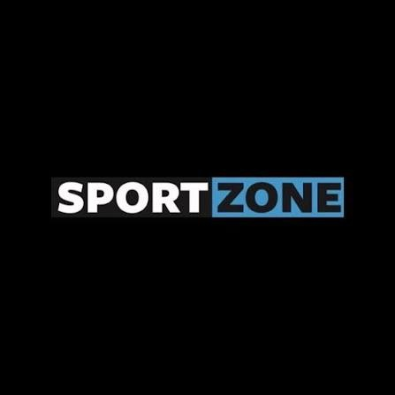

<div align="center">



# SPORTZONE
### Sports Equipment E-Commerce Web Application

**Aplikasi E-Commerce Penjualan Perlengkapan Olahraga Berbasis Web**

<br>


<br><br>

**PROYEK AKHIR PW — IF-A — KELOMPOK 11**

</div>

---

## 📌 Tentang SportZone

**SportZone** merupakan aplikasi e-commerce berbasis web yang dikembangkan sebagai platform penjualan dan pengelolaan perlengkapan olahraga secara online. Aplikasi ini mengintegrasikan aktivitas pelanggan dan administrasi toko dalam satu sistem, mulai dari pengelolaan informasi produk hingga proses pemesanan.

SportZone dibangun menggunakan **Laravel 12**, **PHP**, dan **MySQL**. Pengembangannya menerapkan konsep pemrograman web, pengelolaan basis data relasional, serta pola arsitektur **Model-View-Controller (MVC)**.

Proyek ini disusun sebagai bentuk penerapan materi perkuliahan Pemrograman Web, khususnya dalam membangun aplikasi web yang terhubung dengan basis data dan memiliki alur penggunaan yang terstruktur.

## 🖥️ Preview Aplikasi

### Customer Dashboard

Tampilan halaman pelanggan untuk melihat katalog perlengkapan olahraga dan mengakses aktivitas belanja.

<div align="center">
  
</div>

### Admin Dashboard

Tampilan halaman administrator untuk memantau ringkasan toko dan mengakses pengelolaan operasional.

<div align="center">
  
</div>

## 🎯 Tujuan Pengembangan

- Menerapkan konsep pengembangan aplikasi web menggunakan PHP dan Laravel.
- Menghubungkan aplikasi dengan basis data relasional MySQL.
- Memahami pengelolaan data melalui operasi CRUD.
- Menerapkan autentikasi pengguna dan pembagian hak akses.
- Mengembangkan alur e-commerce dalam satu aplikasi terintegrasi.
- Menerapkan proses pengembangan dan pengelolaan kode menggunakan Git dan GitHub.

## ✨ Gambaran Sistem

SportZone memiliki dua kelompok pengguna utama dengan ruang penggunaan yang berbeda:

| Bagian | Gambaran |
|---|---|
| **Pelanggan (Customer)** | Mengakses katalog produk dan menggunakan sistem untuk aktivitas belanja serta pemesanan. |
| **Administrator (Admin)** | Mengakses area administrasi untuk mengelola data dan memantau aktivitas toko. |

Secara umum, sistem mencakup pengelolaan pengguna, produk, kategori, data transaksi, serta informasi yang diperlukan dalam proses belanja. README ini memberikan gambaran umum proyek dan tidak dimaksudkan sebagai dokumentasi teknis setiap fitur.

## 🛠️ Teknologi yang Digunakan

| Teknologi | Peran dalam Proyek |
|---|---|
| HTML5 | Menyusun struktur halaman web. |
| CSS3 | Mengatur tata letak dan tampilan antarmuka. |
| Bootstrap 5.3 | Membantu membangun komponen dan desain antarmuka. |
| JavaScript | Menambahkan interaksi pada halaman. |
| PHP | Menangani logika dan pemrosesan aplikasi di sisi server. |
| Laravel 12 | Framework utama dengan pola arsitektur MVC. |
| MySQL | Menyimpan dan mengelola data aplikasi. |
| phpMyAdmin | Membantu administrasi basis data MySQL. |
| Git | Mengelola perubahan dan versi kode. |
| GitHub | Menyimpan repositori dan mendokumentasikan proyek. |

## 📚 Materi dan Konsep yang Diterapkan

Pengembangan SportZone menjadi sarana penerapan beberapa materi Pemrograman Web, antara lain:

1. **Dasar pemrograman web** — HTML, CSS, JavaScript, dan PHP.
2. **Framework Laravel** — routing, controller, Blade template, middleware, dan pola MVC.
3. **Basis data** — MySQL, SQL, perancangan tabel, relasi antartabel, dan pengolahan data.
4. **CRUD** — proses menambah, menampilkan, memperbarui, dan menghapus data.
5. **Autentikasi dan session** — registrasi, login, pengelolaan session, serta pembatasan hak akses.
6. **Validasi dan pengelolaan file** — validasi masukan serta proses unggah berkas.
7. **Version control** — penggunaan Git dan GitHub dalam pengelolaan kode proyek.

## 🚀 Menjalankan Proyek

### Persyaratan

Pastikan perangkat telah memiliki:

- PHP yang kompatibel dengan Laravel 12.
- Composer.
- MySQL dan phpMyAdmin (dapat menggunakan XAMPP).
- Node.js dan NPM.

### Langkah Instalasi

1. **Clone repositori**

   ```bash
   git clone https://github.com/USERNAME/NAMA-REPOSITORY.git
   ```

2. **Masuk ke direktori proyek**

   ```bash
   cd NAMA-REPOSITORY
   ```

3. **Install dependency PHP dan frontend**

   ```bash
   composer install
   npm install
   ```

4. **Buat file konfigurasi environment**

   Windows Command Prompt:

   ```bat
   copy .env.example .env
   ```

   Linux/macOS:

   ```bash
   cp .env.example .env
   ```

5. **Buat application key**

   ```bash
   php artisan key:generate
   ```

6. **Atur koneksi database**

   Buat database baru melalui phpMyAdmin, kemudian sesuaikan konfigurasi berikut pada file `.env`:

   ```env
   DB_CONNECTION=mysql
   DB_HOST=127.0.0.1
   DB_PORT=3306
   DB_DATABASE=nama_database
   DB_USERNAME=root
   DB_PASSWORD=
   ```

   Sesuaikan nama database, username, dan password dengan konfigurasi MySQL lokal.

7. **Jalankan migration**

   ```bash
   php artisan migrate
   ```

   Jika repositori menyediakan file SQL atau data awal khusus, ikuti petunjuk database yang disertakan dalam repositori.

8. **Jalankan aplikasi**

   ```bash
   php artisan serve
   ```

9. **Jalankan frontend saat proses pengembangan**

   ```bash
   npm run dev
   ```

   Buka aplikasi melalui alamat:

   ```text
   http://127.0.0.1:8000
   ```

## 🔮 Pengembangan Selanjutnya

Beberapa peluang pengembangan SportZone pada masa mendatang meliputi:

- **Payment Gateway** — mengintegrasikan layanan pembayaran otomatis.
- **Shipping API** — menghubungkan sistem dengan layanan ekspedisi dan pelacakan pengiriman.
- **Product Recommendation** — mengembangkan rekomendasi produk berdasarkan data dan aktivitas pengguna.
- **Advanced Analytics** — memperluas analisis serta visualisasi laporan penjualan.
- **Security Enhancement** — meningkatkan keamanan aplikasi dan perlindungan data.
- **Performance Optimization** — mengoptimalkan kecepatan dan efisiensi aplikasi.

Rencana tersebut merupakan peluang pengembangan lanjutan dan bukan pernyataan bahwa seluruh integrasi tersebut telah tersedia pada versi saat ini.

## 👥 Tim Pengembang

**Proyek Akhir Pemrograman Web — IF-A — Kelompok 11**

| No. | Nama | NIM |
|:---:|---|:---:|
| 1 | Kahfi Hilmy Al Ghathfan | 123250221 |
| 2 | Azka Satria Nugroho | 123250214 |
| 3 | Fachrezza Devin R.P. | 123250209 |

## 📍 Status Proyek

**Status:** Proyek akademik / pengembangan aplikasi web.

SportZone dikembangkan sebagai proyek akhir mata kuliah Praktikum Pemrograman Web. Proyek ini berfokus pada penerapan konsep pemrograman web, integrasi basis data, dan pengembangan aplikasi e-commerce. Penyempurnaan dan pengembangan lebih lanjut dapat dilakukan sesuai kebutuhan.

---

<div align="center">

**SPORTZONE — SPORTS STORE**

*Sports Equipment E-Commerce Web Application*

Dibuat sebagai bagian dari Proyek Akhir Praktikum Pemrograman Web  
**IF-A · Kelompok 11**

</div>
